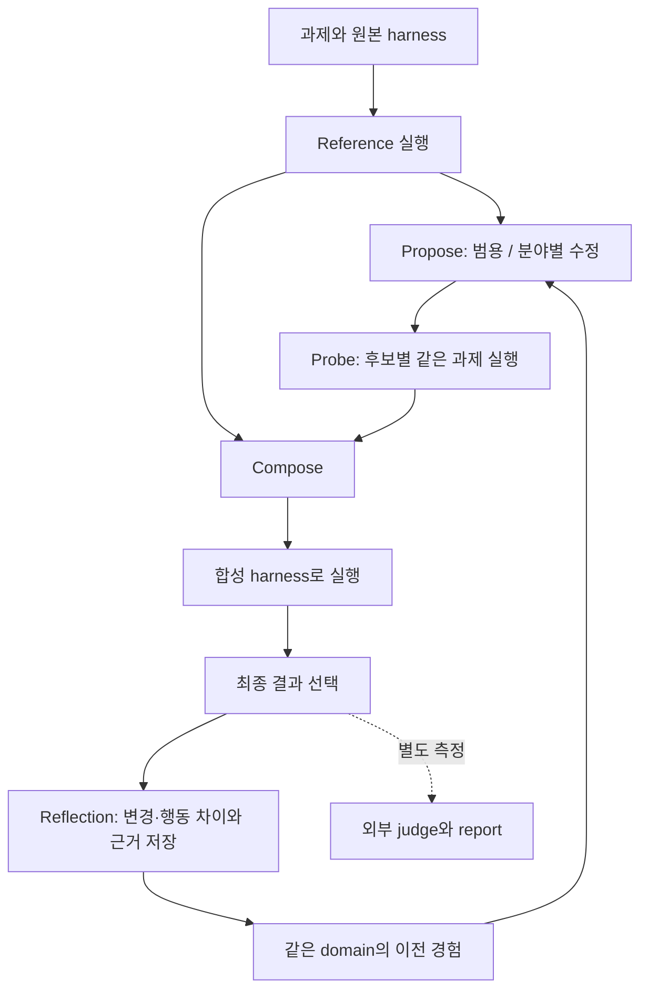

# 원본 Harness²를 실행하는 로컬 호스트

2026-10-26 방향 변경: 원본의 **Propose–Probe–Compose와 과제 간 improvement harness**를 제품의 중심으로 둔다. 알고리즘을 TypeScript로 다시 만들지 않고, Google Research 원본 Python 코드를 고정한 버전으로 직접 실행한다. 이전 [대화 프로토타입 설계](chat-prototype.md)는 별도의 기록이다.

## 원본과 같은 부분

- 원본 커밋: `1cfe254e8d25b15f37048c3730134686abe60335`.
- 구현: [vendor/harness2](../vendor/harness2/README.md)의 `core.schedule`, `core.recursion`, `core.selection`, `core.library`, `core.prompts`를 직접 호출한다.
- 과제별 reference 실행 → 범용/분야별 후보 제안 → 같은 과제의 후보 실행 → 근거 기반 Compose → 합성 harness 실행 → 최종 결과 선택 → Reflection 순서를 유지한다.
- parallel과 sequential을 그대로 지원한다. 각 모드의 과제 실행 예산은 `R=4k`, 개선 단계 예산은 `P=3k`다. 두 모드를 함께 돌릴 때 reference 실행은 공유한다.
- selection pool은 원본처럼 합성 결과들만 포함한다. 기본 실행이나 중간 후보 결과를 별도의 후보로 끼워 넣지 않는다. `k=1`에서는 최종 결과 하나를 별도 selector 호출 없이 전달한다. Composer는 근거에 따라 기존 harness를 유지할 수 있다.
- 과제는 같은 domain 안에서 순서대로 처리한다. 개선 에이전트는 앞선 과제의 채택 harness와 관찰 근거만 참고한다. 다음 과제의 실행 harness를 직전 결과로 무조건 덮어쓰지 않는다.
- 개선 과정에는 benchmark 정답·채점 결과를 넣지 않는다. `judge`와 `report`는 결과 선택 이후의 별도 명령이다. 테스트 통과 점수로 개선 후보를 고르는 수동 A/B 루프로 바꾸지 않는다.
- 원본의 8개 편집 대상과 실행기별 검증 규칙을 그대로 둔다. instructions-only 대화 bundle을 원본 harness로 취급하지 않는다.

## 사용 흐름

기본 원본 명령은 `npm run harness2 -- <명령> ...`이다. `npm start -- --harness2 <명령> ...`도 같은 호스트로 연결한다. 원본 실행에 기존 chat 설정을 합치거나 사용자의 현재 대화에 시험 입력을 끼워 넣지 않는다.

| 명령 | 동작 |
|---|---|
| `demo` | 원본의 deterministic editor와 실제 Python 실행으로 두 과제·PPC·Reflection·경험 전달·재개를 확인 |
| `verify` | 고정된 source와 로컬 호환 패치의 LF 기준 SHA256 확인 |
| `test` | 원본 회귀 테스트와 호스트/운영체제 호환 검사 |
| `run` | 원본 `harness2.cli.run_sweep` 위임 |
| `judge` / `report` | 원본 외부 채점·보고 명령 위임 |
| `setup` / `check` | 원본 benchmark 준비·사전 검사 위임 |

`demo`는 모델을 호출하지 않는다. 편집·선택은 원본의 scripted fixture다. 이 결과로 LLM의 자기 개선 성능이나 실제 프로젝트 품질 향상을 주장하지 않는다. 산술 오류 수정이 관찰된 것은 재현 가능하지만, 그 수정은 미리 정해진 데모 편집이다.

## 코드와 실행 환경

- Node/TypeScript는 실행 인자·프로세스 수명·출력 전달만 담당한다. 알고리즘의 단계·순서·선택·Reflection을 복제하지 않는다.
- Python 3.12/3.13을 사용한다. `HARNESS2_PYTHON`으로 실행 파일을 지정할 수 있다.
- 원본 source는 Git object에서 추출하며 줄바꿈만 LF로 통일한다. 출처·커밋·원본 및 적용 파일 hash는 [PROVENANCE.json](../vendor/harness2/PROVENANCE.json)에 기록한다. upstream 파일 수정은 패치 재생성 스크립트에 명시해야 한다.
- Windows에서는 Linux `flock` 대신 실제 OS byte lock을 사용한다. summary 교체는 Windows의 일시적인 파일 공유 오류만 짧게 재시도하며 한도 뒤에는 실패를 반환한다. harness 파일의 내부 키는 POSIX 경로로 통일한다. 이것이 로컬 호환 패치의 전부다.
- 실제 모델을 사용하는 원본 benchmark는 **Linux/WSL**에서 원본 의존성·모델·인증을 설정해 실행한다. Windows native 호스트는 `demo`, `verify`, `test`, 각 명령의 도움말을 지원한다. native에서 benchmark를 부분 실행하거나 다른 adapter로 몰래 대체하지 않는다.
- 원본 모델 실행은 설치된 일반 Codex/Claude 대화 프로필과 별도다. 예를 들어 원본 Codex executor pin은 `0.144.6`, 기존 chat adapter는 `0.163.0`이다. 같은 것으로 취급하지 않는다.
- 원본 공개 benchmark 실행은 network/권한 격리를 자동 보장하지 않는다. 실제 실행은 준비한 Linux 일회용 환경에서 진행하고 원본의 네트워크/채점 기준 접근 제약 안내를 따른다.

## 저장과 소유권

데모 기본 출력은 `.terminal-runner/harness2/demo-<id>/`다. `--output`으로 같은 폴더를 지정하면 원본 resume를 사용한다. 출력 폴더에는 고정 source·mode·k를 기록하는 소유권 marker를 만들며, marker 없는 기존 작업 폴더나 다른 설정의 결과 폴더를 덮어쓰지 않는다. 같은 출력의 동시 데모는 OS lock으로 순서대로 실행한다.

원본의 `summary.json`, 단계별 harness, 실행 기록, selection, reflection, domain library를 보존한다. 외부 채점 결과는 개선 입력에 합치지 않는다. 기존 chat의 `state.sqlite`와 native thread/session은 이 저장 구조에 가져오지 않는다.

## 현재 검증과 다음 연결

현재 구현은 원본 코어와 benchmark 명령에 도달하는 실행 호스트, Windows 호환 패치, 모델 없는 원본 전체 흐름 검증이다. `k=1/2`, 두 모드, `4k/3k` 예산, finals-only 선택, 앞선 과제만 전달, 미완료 경험 제외, 잘못된 수정 재시도와 기존 결과 재개를 검사한다.

실제 사용자 프로젝트의 요청을 원본 `BenchmarkAdapter`/`Substrate` 계약으로 연결하는 작업과, 원래 CLI의 모든 기능을 보존하는 내장 대화 화면은 아직 구현하지 않았다. 다음 단계는 이 원본 과제 실행 경로에 프로젝트 adapter를 추가하는 것이다. 기존 대화 프로토타입을 원본 Harness²가 완성된 것처럼 표시하지 않는다.

참조: [원본 README](https://github.com/google-research/harness2), [원본 실험 설명](https://github.com/google-research/harness2/blob/main/docs/EXPERIMENTS.md), [원본 BenchmarkAdapter](https://github.com/google-research/harness2/blob/main/harness2/core/spec.py).
