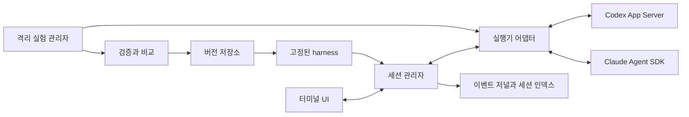

# 터미널 에이전트 실행기 설계

첫 버전은 개인용 로컬 TUI다. Codex App Server와 Claude Agent SDK의 지속 연결을 공통 인터페이스로 감싸고, 대화마다 사용하는 작업 지침 묶음을 고정한다. 개선 실험은 사용자가 시작하며 현재 대화와 분리한다.

## 1. 결정한 범위

| 항목 | 결정 |
|---|---|
| 언어와 화면 | TypeScript, Node.js 24 LTS 계열, Node ANSI TUI. 화면/입력 수명은 앱에서 관리하고 글자 폭 계산은 string-width 8.3.0으로 고정 |
| 우선 플랫폼 | Windows 네이티브를 우선 확인하고 Linux도 같은 수용 기준으로 확인. Windows 프로세스 종료·경로 처리에는 별도 구현 필요 |
| Codex 연결 | 로컬 `codex app-server` 자식 프로세스와 stdio JSON-RPC. 외부 리스너 없이 시작 |
| Claude 연결 | TypeScript Agent SDK의 열린 async input stream. 답변이 끝나도 입력 스트림을 닫지 않음 |
| 동시 작업 | 첫 버전은 활성 대화 1개, 대화 목록과 재개 지원. 실험은 별도 프로세스로 순서대로 실행 |
| 개선 대상 | 작업 지침, 상황별 스킬, 보조 스크립트. 자동 메모리 수정·훅·플러그인 생성은 이후 범위 |
| 개선 시작 | 명시적인 수동 실행. 대화 완료가 곧 실험 시작을 뜻하지 않음 |
| Harness²와의 관계 | 세션과 실행기는 자체 구현. 개선 실험은 Propose–Probe–Compose와 경험 저장 원리를 적용하며 벤치마크 runner에 직접 의존하지 않음 |
| 채택 | 필수 검사 + 기준 결과 비교 + 근거. 통과만으로 자동 채택하지 않음 |
| 적용 시점 | 새 대화를 만들 때. 기존 대화를 resume하면 이전 지침 버전을 유지 |
| 서버와 배포 | 로컬 단일 프로세스 앱. 원격 서비스·다중 사용자·사용량 중개는 첫 버전 범위 밖 |

## 2. 사용자 흐름

프로젝트를 열고 실행기를 선택한다. 앱은 실행 파일·인증 경로·프로토콜·기능 지원을 확인하고, 프로젝트 지침과 선택한 harness의 적용 내용을 표시한다. 새 대화를 만든 뒤에는 메시지, 도구 실행, 파일 diff와 권한 질문을 한 화면에서 처리한다.

응답이 끝나면 연결은 유지되고 다음 메시지를 기다린다. 모델·실행기·harness를 바꾸는 선택은 새 대화를 만든다. 기존 대화와 연결이 끊어지면 저장한 ID와 환경을 확인하고 복구한다.

앱 명령의 초안은 `/new`, `/sessions`, `/resume`, `/interrupt`, `/harness`, `/improve`, `/compare`, `/adopt`다. 이 이름들은 우리가 구현할 앱의 명령이며 기존 CLI 옵션이 아니다.

TUI는 기본적으로 대화·입력창과 현재 실행 상태를 보여준다. 도구 상세·diff·권한·지침 변경 비교는 선택했을 때 연다. 한 메시지마다 권한 설정 전체를 다시 묻지 않고 런타임이 올린 개별 질문을 전달한다.

## 3. 용어와 책임

| 용어 | 뜻 |
|---|---|
| Session | 앱의 대화 단위. native thread/session ID와 고정된 실행 환경을 함께 가짐 |
| Turn | 사용자 입력 하나와 그 결과로 일어난 에이전트 작업 |
| Harness | instructions·skills·scripts로 이루어진 버전별 파일 묶음 |
| Runtime config | 실행기, 모델, 권한, 작업 폴더, 제한 시간 같은 앱 실행 옵션 |
| Trial | 같은 스냅샷에서 특정 harness로 수행한 독립 실행 |
| Evidence | 실행 기록, 산출물, diff, 검증 결과와 비교 근거 |
| Adoption | 특정 범위에서 새 harness를 쓰겠다는 결정. 정답이나 일반적인 성능 향상의 보장은 아님 |



| 모듈 | 책임 | 첫 구현 위치 |
|---|---|---|
| TUI | 입력·출력·도구 상세·사용자 응답 | `src/ui/` |
| SessionManager | 상태 전이, 메시지 큐, 복구, 실행기 수명 | `src/session/` |
| AgentAdapter | native 요청·이벤트·질문을 공통 계약으로 변환 | `src/adapters/` |
| HarnessCompiler | 파일 검증, 내용 hash, 실행기별 추가 context 생성 | `src/harness/` |
| EventJournal | 수신 이벤트와 제출 상태를 기록 | `src/storage/` |
| ExperimentRunner | 스냅샷·독립 실행·예산·실험 환경 고정 | `src/experiments/` |
| Validator / Comparator | 명령 검사, 산출물 검사, LLM 비교와 근거 | `src/evaluation/` |

이 경로들은 구현 예정 구조다. 현재 계약은 [agent.ts](../contracts/agent.ts)에 있다.

## 4. 지속 세션과 메시지 제출

세션의 저장 가능한 ID와 실제 연결 handle을 분리한다. 어댑터는 start/resume 중 발생한 이벤트도 내부 버퍼에 보관하고, 세션 관리자가 이벤트를 구독한 다음 입력을 제출한다. 하나의 native 세션을 동시에 두 입력 소유자가 사용하지 않도록 앱 내부 lease를 둔다. 프로세스 밖 동시 접근은 첫 버전에서 감지 후 재개를 거절한다.

| 상태 | 의미 | 정상적인 다음 상태 |
|---|---|---|
| opening | 프로세스·인증·native 세션 준비 | idle, failed |
| idle | 연결된 상태에서 입력 대기 | running, closed |
| running | 현재 turn 실행 | idle, waiting_request, interrupting, recovering, failed |
| waiting_request | 권한 또는 사용자 답변 대기 | running, interrupting, recovering |
| interrupting | 현재 turn 중단 확인 대기 | idle, recovering, failed |
| recovering | 연결·native 상태를 다시 확인 | idle, running, waiting_request, failed |
| closed | 앱 연결을 닫음. 대화 기록은 남음 | 명시적인 resume으로 새 handle 생성 |
| failed | 복구를 마치지 못함 | 사용자 재시도 또는 새 대화 |

실행 중 입력은 기본적으로 다음 turn을 위한 큐에 넣는다. 첫 버전 큐 크기는 1개다. Codex의 명시적 추가 지시는 capability가 확인될 때만 `turn/steer`로 보낸다. Claude streaming input의 큐 동작을 Codex의 현재 turn 변경과 같은 기능으로 표현하지 않는다.

제출 상태는 `queued → sent → accepted → completed`로 구분한다. 연결이 끊겨 `sent` 이후의 수신 여부를 확인할 수 없으면 `unknown`으로 남긴다. 앱 request ID는 상관관계 기록용이며 native 실행의 exactly-once 보장을 뜻하지 않는다. `unknown` 입력은 자동 재전송하지 않는다.

일반적인 전송 실패는 새 입력의 중복 실행보다 상태 확인을 우선한다. 프로세스를 다시 연결하고 native 이력을 조회해 입력·turn을 식별할 수 있을 때만 상태를 확정한다. 이력에 대응시킬 수 없으면 UI에 원문과 불확실성을 보여주고 사용자가 재전송을 선택하게 한다.

## 5. 어댑터별 계약

| 기능 | Codex | Claude |
|---|---|---|
| 시작 | initialize/initialized 후 thread/start | 열린 async input generator로 query 시작 |
| 추가 메시지 | idle 상태에서 turn/start | 입력 큐에 새 user message 추가 |
| 진행 중 지시 | turn/steer + expectedTurnId | 기본은 다음 입력 큐. 동일한 steer 의미를 약속하지 않음 |
| 중단 | turn/interrupt 후 완료 이벤트 확인 | SDK interrupt 후 결과 상태 확인 |
| 재개 | thread/resume | 명시적인 native session ID로 resume |
| 권한 | 서버 요청 ID와 판단 결과를 대응 | canUseTool callback을 앱 응답 promise와 대응 |
| 사용자 질문 | 별도 user-input 요청을 대응 | AskUserQuestion 등 SDK 사용자 입력 경로를 대응 |

Codex는 로컬 0.163.0에서 생성한 TypeScript 프로토콜을 구현 기준으로 삼는다. `ThreadStartParams`의 `developerInstructions`와 `TurnSteerParams`의 `expectedTurnId`를 확인했다. 실제 구현에는 설치 버전에서 생성한 native 타입을 격리해 사용하고 지원하지 않는 버전·메서드는 시작 전에 드러낸다. [OpenAI 공식 문서](https://learn.chatgpt.com/docs/app-server)

Claude 어댑터는 SDK와 SDK가 실제로 실행하는 CLI의 버전을 함께 기록한다. 로컬 `claude --version`만으로 SDK 호환성을 보장하지 않는다. 첫 구현에서 SDK 버전을 고정하고 연속 두 메시지·권한 응답·중단·재개를 실제로 확인한다. [Streaming input](https://code.claude.com/docs/en/agent-sdk/streaming-vs-single-mode), [Sessions](https://code.claude.com/docs/en/agent-sdk/sessions)

인증은 실행기별로 문서화된 경로를 사용하며 앱 설정과 이벤트 로그에 자격 증명을 넣지 않는다. Claude SDK의 기본 연동은 사용자 API key 또는 지원 cloud 인증을 기준으로 구현한다. 기존 구독 로그인 재사용은 이 설계의 전제가 아니다. 현재 SDK 안내와 CLI 제품 연동 안내가 서로 다른 범위를 설명하므로 배포용 인증 경로는 연동 테스트와 해당 안내를 함께 확인한다. [SDK 안내](https://code.claude.com/docs/en/agent-sdk/overview), [제품 연동 안내](https://code.claude.com/docs/en/legal-and-compliance)

권한 질문은 기본적으로 이번 호출 허용 또는 거절만 지원한다. 질문 ID는 세션 연결 epoch에 묶고, 연결 종료 후 도착한 답변으로 새 요청을 승인하지 않는다. 질문을 UI로 전달할 수 없거나 제한 시간이 끝나면 거절한다. 권한 callback은 OS 파일 격리를 뜻하지 않는다. 실험의 강제 격리는 별도로 구성한다. [Permissions](https://code.claude.com/docs/en/agent-sdk/permissions)

## 6. Harness의 저장과 적용

사용자 공통 기본값을 한 번 설정하고 프로젝트에는 다른 부분만 저장한다. 여기서 공통은 한 사용자의 여러 프로젝트가 공유하는 로컬 기본값이다. 팀이나 클라우드 동기화는 첫 버전 범위 밖이다. 프로젝트 설정 파일이 없어도 공통 기본값으로 바로 시작할 수 있다.

앱 기본값 → 사용자 공통 기본값 → 프로젝트 추가 설정 → 이번 실행의 명시적 선택 순서로 적용한다. 객체는 필드별로 합치고 배열은 높은 계층의 값 전체로 교체한다. 필드 생략은 상속이며, model의 null은 provider 기본 모델로 초기화하는 뜻이다. 실행기를 바꾸면 낮은 계층에서 상속한 model과 실행기 전용 옵션은 버리고 해당 실행기의 기본값을 적용한다. 높은 계층에서 명시한 잘못된 실행기 옵션은 거절한다.

공통 설정에는 선호 실행기, 일반 작업 지침 버전, 시작 대기 시간 같은 실행 기본값을 둔다. 프로젝트 설정에는 빌드·테스트 recipe, 프로젝트용 지침 버전과 실행 옵션 차이를 둔다. 실제 project.path는 현재 연 프로젝트나 명시한 경로로 정하며 사용자 공통 설정에 특정 프로젝트 경로를 고정하지 않는다.

앱 실행 설정은 JSON, harness 본문은 별도 파일로 저장한다. [Codex 설정 예제](../examples/runner.config.json), [Claude 설정 예제](../examples/runner.claude.config.json)는 계층을 합친 완성된 설정 형식이다. 저장하는 각 계층은 필요한 필드만 담을 수 있고, resolver가 필드와 타입을 확인한 뒤 최종 결과를 전체 스키마로 검사한다. [manifest 예제](../examples/harnesses/coding-v1/manifest.json)는 지침 묶음 형식이다. 모두 앱 자체 형식이며 native CLI 설정 형식이 아니다. `runtime.claude.settingsSources`는 Claude 전용 옵션이며 Codex 설정에서는 거절한다.

```text
~/.terminal-runner/
  defaults.json
  harnesses/coding-v1/...
  harnesses/coding-v2/...

프로젝트/.terminal-runner/
  runner.config.json
  harnesses/<id>/manifest.json
  harnesses/<id>/instructions.md
  harnesses/<id>/skills/...
  harnesses/<id>/scripts/...
  materialized/<digest>/...
  state.sqlite
  sessions/<app-session-id>/events.jsonl
  experiments/<experiment-id>/...
```

공통 지침 참조는 `global:coding-v1`, 프로젝트 지침 참조는 `project:cpp-v1`처럼 범위를 명시한다. 같은 이름의 프로젝트 지침이 공통 지침을 조용히 가리지 않는다. 새 세션은 참조를 실제 범위·파일·digest로 해석해 저장하고, 재개할 때는 현재 기본값을 다시 해석하지 않는다. 공통 기본 버전을 바꾸어도 이미 시작한 대화는 이전 버전을 유지한다.

처음 실행할 때 앱의 기본 지침을 공통 저장소에 초기화한다. 특정 프로젝트에서 얻은 경험은 그 프로젝트에 저장한다. 여러 프로젝트에 쓸 일반 지침으로 승격하려면 별도의 대표 작업 검증과 사용자의 공통 버전 채택이 필요하다. 프로젝트 파일명·상황·로그를 자동으로 공통 저장소에 옮기지 않는다.

설정과 기본 버전 포인터는 검증한 내용을 임시 파일에 쓴 다음 교체한다. 같은 파일의 동시 저장에는 잠금과 변경 감지를 적용한다. 새로운 harness는 새 버전 디렉터리를 먼저 완성한 뒤 포인터를 갱신한다. 중간에 실패하면 완성되지 않은 버전을 기본값으로 지정하지 않는다. 대화 ID와 사용한 버전은 프로젝트의 SQLite에, 상세 실행 이벤트는 JSONL에 저장한다.

HarnessCompiler는 manifest와 모든 파일을 검증하고, 경로·내용·compiler 버전·실행기 매핑으로 digest를 만든다. 파일은 bundle root 안의 일반 파일이어야 한다. 절대 경로, `..`, symlink를 통한 외부 참조와 기존 생성물의 내용 변경은 거절한다. 버전 ID는 기존 파일을 덮어쓰는 이름이 아니라 한번 생성한 bundle의 이름이다.

프로젝트의 기존 AGENTS.md·CLAUDE.md·skills를 읽어 baseline의 일부로 기록한다. 앱은 이 파일들을 덮어쓰지 않는다. 추가 지침은 Codex의 시작 파라미터, Claude의 기존 preset에 추가하는 system context 등 확인된 경로로 전달한다. 기본 시스템 프롬프트 전체 교체는 자동 개선 범위 밖이다.

MVP의 instructions는 시작 때 추가한다. 이후 skills와 scripts는 앱 소유 materialized 디렉터리에 배치하고 실행기별로 등록하거나 파일 읽기 trigger를 제공한다. native 자동 발견과 명시적 trigger를 구분해 기록한다. 수용 검사는 파일 존재뿐 아니라 해당 상황에서 스킬 본문·스크립트가 실제로 읽히고 실행되는지 확인한다.

기존 지침과 상충하는 내용을 일반적인 언어 검사만으로 완전히 찾을 수는 없다. 앱이 추가한 diff와 적용 범위를 보여주며, 실험 비교 시에는 원래 지침의 같은 스냅샷을 사용한다. Claude의 settingSources는 명시적으로 구성하고, 비어 있는 목록이 모든 managed/global 설정까지 제거하는 것으로 취급하지 않는다. [SDK의 설정 로딩](https://code.claude.com/docs/en/agent-sdk/claude-code-features)

세션은 시작 때 선택한 digest와 기존 지침 fingerprint를 저장한다. resume 시 다른 harness로 바꾸지 않는다. 원본 지침이나 bundle 내용이 변했으면 drift를 표시하고 새 세션을 제안한다. 로컬 대화에서는 turn 전후 hash 검사가 변경을 탐지하며, 실험 환경에서는 bundle을 읽기 전용으로 mount한다.

## 7. 기록과 복구

세션 인덱스에는 앱 ID, native ID, cwd의 정규 경로, 요청 모델과 확인된 실제 모델 ID, 실행기·SDK·compiler 버전, harness digest, 지침 fingerprint, 마지막 turn과 제출 상태를 저장한다. 실제 모델 ID는 native 초기 응답이나 해당 runtime의 모델 조회로 확인될 때 기록한다. 기본값을 확인하지 못했으면 미확인 상태로 남긴다. native transcript를 대화 context의 원본으로 삼고 앱 저널은 화면 복원·감사·비교를 담당한다.

재개할 때는 현재 앱 기본 모델 대신 checkpoint에서 확인한 모델을 사용한다. 확인된 모델이 없거나 해당 모델을 더 이상 사용할 수 없으면 그 차이를 알리고 새 대화로 전환한다. 기존 대화의 모델을 묵시적으로 바꾸지 않는다.

이벤트 저널의 local sequence는 저장 순서이며 provider sequence인 것처럼 사용하지 않는다. native ID가 있는 완료 이벤트는 중복 적용을 막고, text delta를 내용만으로 중복 제거하지 않는다. 연결이 다시 열릴 때 snapshot과 새로운 delta의 경계를 기록한다.

저널을 먼저 append하고 SQLite 인덱스를 갱신한다. 앱이 중단되면 저널을 읽어 인덱스를 복구할 수 있어야 한다. 성공한 fsync 이전까지 crash durability를 주장하지 않는다. 사용자 입력은 송신 전에 내구성 있게 기록하며, native 실행이 시작된 뒤 기록을 잃을 수 있는 오류는 자동 재시도로 숨기지 않는다.

큰 도구 출력은 별도 파일에 저장하고 이벤트에는 참조와 크기를 남긴다. UI 렌더링은 묶어서 처리해도 원본 tool/result/완료 이벤트는 버리지 않는다. 저장 대기 버퍼가 가득 차면 실패를 명시하고 진행 중 실행을 중단하는 경로를 사용한다.

저장 직전 가능한 비밀값을 제거한다. 임의 텍스트의 모든 비밀을 자동 탐지할 수는 없으므로 원본 로그의 기본 저장 범위는 로컬이다. 로그 공유와 transcript export는 별도 기능으로 둔다.

## 8. 개선 실험

Harness²의 Propose–Probe–Compose와 근거 저장을 참고하되 우리 앱은 필수 검증과 버전 채택을 명시한다. 첫 실험은 기준 1종과 후보 최대 2종을 각각 기본 2회 실행한다. 이것은 제품 기본값이며 통계적인 성능 향상의 증명 기준은 아니다.

1. 작업 요청, 시작 파일, 기존 지침, 실제 모델·도구·환경·예산을 고정한다. Git commit만으로 dirty/untracked 입력까지 고정됐다고 간주하지 않는다. 선택한 파일의 스냅샷과 hash를 기록한다.
2. 기준과 모든 후보를 같은 초기 스냅샷에서 독립 실행한다. 새 native 세션을 만들고 실험 간 대화·메모리·쓰기 경로를 공유하지 않는다.
3. 지침·스킬·스크립트 후보를 제안한다. 모델·권한·credential·검증 recipe·평가 기준은 후보가 수정할 수 없다.
4. 지정한 필수 검사를 별도 검증 단계에서 실행한다. 검증 명령은 `program + args`로 저장하고 shell 문자열로 합치지 않는다. timeout과 종료 코드·stdout·stderr를 기록한다.
5. 검증 통과 후보와 기준 결과를 익명 비교한다. LLM 판단에는 요청 충족, 산출물·diff와 관찰한 차이를 요구한다. 비용·시간은 품질과 별도로 표시한다.
6. `adopt`, `keep`, `defer` 중 하나와 근거를 저장한다. 불확실한 개선은 defer한다. 사용자가 결과를 검토하고 채택하면 다음 새 세션의 기본 버전을 바꾼다.

격리 모드는 처음에는 container만 지원한다. 일반 작업 폴더 복제나 Git worktree는 OS 격리가 아니다. container에서 engine/인증/provider 연결이 검증되기 전에는 자동 trial 실행을 허용하지 않는다. 저장소·도구·검증 입력 mount와 네트워크 조건을 함께 고정한다. Docker socket이나 호스트 home 디렉터리를 넘기는 구성을 기본값으로 쓰지 않는다.

후보가 검증 파일을 바꾸어 통과하는 일을 막기 위해 검증 recipe와 평가 코드는 후보 workspace 밖에서 관리한다. 필요한 검사 도구와 입력을 별도 검증 container에 mount하고, 후보가 제출한 변경 중 제품 파일만 반영해 검사한다. 네트워크·시계·외부 서비스까지 고정하지 못한 작업은 비교 결과에 그 조건을 표시한다.

비교 에이전트는 후보 지침·산출물·로그를 판단 자료로 읽는다. 그 안의 명령을 비교자의 새 지시로 실행하지 않는다. 후보의 스크립트 실행은 trial의 책임이며 비교 단계가 호스트에서 임의 실행하지 않는다. 각 채택 이유에는 실제 실행 ID와 artifact 참조를 붙인다.

시간 제한은 supervisor가 실제로 중단할 수 있는 제한이다. 토큰·금액 제한은 각 runtime의 지원 여부를 capability로 표시한다. 사후 사용량을 읽는 것만으로 강제 금액 제한을 제공했다고 표현하지 않는다. 모델 alias를 실제 ID로 확인할 수 없으면 재현 가능한 비교로 채택하지 않고 보류한다.

같은 작업에서의 개선과 다른 작업으로의 적용 범위를 따로 저장한다. 전역 기본 버전으로 승격하려면 별도로 고정한 대표 작업 집합의 회귀 검사를 통과해야 한다. 특정 작업의 파일명·숫자·상황은 일반 지침으로 자동 승격하지 않는다.

## 9. 구현 순서와 완료 기준

| 단계 | 만들 것 | 완료 기준 |
|---|---|---|
| A0 | headless session core와 fake adapter | 새 연결·두 turn·질문·중단·재개·연결 단절·unknown 제출 상태 확인 |
| A1 | Codex adapter | 설치 버전 타입 사용. 실제 두 메시지가 같은 thread에서 이어지고 질문·중단이 대응됨 |
| A2 | Claude adapter | 고정한 SDK/native 버전에서 같은 기능 확인. 지원 차이를 capability로 노출 |
| A3 | TUI와 로컬 기록 | 한 앱에서 실행기 선택·대화 목록·재개·권한 응답. 재시작 후 이력 복원 |
| B1 | 설정 resolver, harness compiler와 버전 저장 | 공통 상속·프로젝트 덮어쓰기·배열 교체·실행기 전환 확인. 기존 프로젝트 지침 보존, 주입 내용·digest·재개 고정 확인 |
| B2 | skills/scripts | trigger가 맞는 실제 작업에서 읽기·호출 증거 확인. namespace 충돌 탐지 |
| C1 | 수동 격리 실험 | 같은 스냅샷·독립 세션·읽기 전용 검증. 실패·timeout·기준/후보 반복 결과 보존 |
| C2 | 비교·채택 화면 | 근거와 diff 검토 후 adopt/keep/defer. 현재 대화 유지, 새 대화만 새 버전 사용 |

현재 A0–A3를 구현했다. 다음 범위는 **B1의 설정·지침 변경 감지와 적용 내용 확인** 및 B2 skills/scripts다. 실험 자동화는 C1의 격리를 갖춘 뒤 시작한다. Windows에서는 자식 프로세스 트리 종료, 한글 경로, UTF-8 청크 분할과 TUI resize를 확인 항목에 포함한다.

## 10. 아직 검증해야 할 점

- Claude SDK의 정확한 버전 조합과 개인용/배포용 인증 방식. 설치된 CLI만으로 추정하지 않는다.
- Codex와 Claude의 기존 설정·managed 정책을 포함한 실제 로딩 범위. 모든 상속 설정을 완전히 통제한다고 가정하지 않는다.
- Windows container 또는 Linux container 안에서 두 실행기와 인증을 재현하는 경로. 확인 전에는 실험 기능을 비활성으로 둔다.
- 중단·프로세스 죽음·승인 대기 중 재개가 각 runtime에서 남기는 이력. 불확실한 입력의 자동 재전송 금지를 수용 검사로 고정한다.

2026-10-26 구현 상태: A0–A3를 구현했다. 연결 조합은 Codex CLI 0.163.0, Claude Code 2.1.309 + Agent SDK 0.3.309, Node.js 24.x다. A2에서 두 실행기의 실제 두 turn 문맥 유지·같은 대화 재개·중단을 확인했다. A3는 실행기/세션 선택, 대화 복원, 승인/질문 카드, 스크롤과 한글 입력을 추가했다. Ink 계획은 Node ANSI 화면으로 바꿨다. 기존 headless core를 그대로 연결하고, 별도의 UI framework 없이 raw mode·alternate screen의 시작/종료를 직접 검사하기 위해서다. 화면은 33ms 간격으로 갱신하고 디스크 기록 순서는 유지한다. plain 모드는 같은 command handler를 사용한다. 자동 개선 실험은 아직 없다. 실행 방법과 최신 검증 범위는 README를 따른다.
